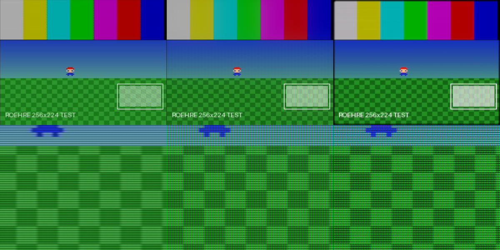

# roehre: Recherche und Plan (Etappe 0)

Stand: 2026-11-02 · Status: **freigegeben, Bau läuft** (Entscheidungen in Abschnitt 10)

Dieses Dokument legt fest, was `roehre` von wem übernimmt, unter welcher Lizenz, wie die
Bibliothek aufgebaut ist, welche Voreinstellungen es gibt, wie das Gehäuse (Bezel) entsteht
und in welchen Etappen gebaut wird. Was hier steht, ist geprüft (Repository, Commit, Lizenzkopf).
Wo etwas nur vermutet ist, steht das dabei.

---

## 1. Ergebnis der Recherche

### 1.1 Geprüfte Vorlagen

| Vorlage | Autor | Lizenz (geprüft) | Geprüfter Commit | Urteil |
|---|---|---|---|---|
| **librashader** 0.12.1 | Ronny Chan (SnowflakePowered) | MPL-2.0 (wahlweise GPL-3.0) | `07ac790c` (2026-10-12) | **Unterbau.** Führt RetroArch-slang-Presets aus, Laufzeiten für wgpu, Vulkan, D3D11/12, Metal, OpenGL, plus C-API. Subframes (`CurrentSubFrame`/`TotalSubFrames`) sind eingebaut. `ShaderPreset` hat öffentliche Felder, also lassen sich Ketten **im Speicher zusammensetzen**, ohne `.slangp`-Dateien zu schreiben. Shader-Cache (`librashader-cache`) und vorverarbeitete Pakete (`librashader-pack`) sind vorhanden. |
| **crt-guest-advanced** (+ `-ntsc`, `-pal`, `-hd`, `-fast`) | guest(r) | GPL-2.0-or-later | slang-shaders `a02157c6` (2026-10-31) | **Hauptröhre.** Am vollständigsten und seit 2018 gepflegt: Scanlines mit helligkeitsabhängiger Breite, viele Masken (Aperture Grille, Slot, Shadow) mit eigener Größe, Afterglow (Nachglühen), Dekonvergenz, Bloom, Halation, Glow, Helligkeitsausgleich, Farb-LUTs (Trinitron, NEC, NTSC), Wölbung, Interlace-Modi. Die `-hd`-Variante ist für hochaufgelöstes Eingangsmaterial gebaut. |
| **crt-beans** (rgb, s-video, composite, vga, fast) | Andrew Duffey | **MIT** | in slang-shaders `a02157c6` | **Zweite Röhre, permissiv.** Physikalisch sauber: analytische Scanlines, Strahlbreite in FWHM, „dynamische“ Maske mit fester Triadenzahl unabhängig von der Monitorauflösung, kein Helligkeitsverlust durch die Maske, VGA-Modus mit Linienverdopplung. Grundlage einer reinen MIT-Variante. |
| **Cathode Retro** (slang-Portierung) | DeadlyRedCube (Josh Jersild), Portierung durch libretro | **MIT** | Upstream-Stand Nov. 2023, in slang-shaders `a02157c6` | **Signalstufe.** Erzeugt echtes Composite/S-Video-Signal mit Phasenmodell je Zeile (wichtig für SNES/NES-typischen Dot-Crawl), dekodiert es wieder, dazu Rauschen und Bildlage-Instabilität. |
| **guest NTSC-Pässe** (`ntsc-pass1/2`, Teil von crt-guest-advanced-ntsc) | guest(r), basiert auf Themaister-NTSC | GPL-2.0-or-later | `a02157c6` | **Signalstufe (Alternative).** Schnell und auf guest-advanced abgestimmt. |
| **Blur Busters CRT Beam Simulator** | Mark Rejhon, Timothy Lottes | **MIT** | `734786a6` (2025-12-29) | **Strahlsimulation** für Monitore ab 120 Hz. Liegt auch als `subframe-bfi/crt-beam-simulator.slangp` in slang-shaders vor und läuft damit direkt über die Subframe-Schnittstelle von librashader. |
| subframe-bfi (`120hz-safe-BFI`, `bfi-simple` …) | div. | je Datei prüfen | `a02157c6` | Einfache Black-Frame-Insertion als leichte Stufe. |
| **crt-royale** | TroggleMonkey | GPL-2.0-or-later | `a02157c6` | **Referenz**, keine Hauptröhre: sehr genaue, gekachelte Phosphormasken bei hoher Ausgabeauflösung, aber teuer und sehr viele Pässe. Für den Abgleich der Lochmasken-Optik in 4K/8K. |
| **koko-aio** | kokoko3k | GPL-3.0, einzelne Funktionen **CC BY-SA** (z. B. `ntscdec()`) | `bb4476a4` (2026-10-27) | **Ideengeber** für Umgebungslicht, Bezel-Spiegelung und adaptive Strobe-Technik. Wird nicht als Code übernommen (CC-BY-SA-Mischung ist unhandlich). |
| **Mega Bezel** | HyperspaceMadness | GPL-3.0 | in slang-shaders `a02157c6` | **Ideengeber** fürs Gehäuse (Spiegelung im Rahmen, Wölbung des Glases). Kein Code und **keine Grafiken** übernommen; das Gehäuse entsteht vollständig selbst (Abschnitt 5). |
| Sony Megatron (HDR) | MajorPainTheCactus | **keine Lizenzangabe in den Dateien gefunden** | `a02157c6` | **Nicht übernehmen**, solange die Lizenz ungeklärt ist. Das Prinzip (in HDR die Maske mit voller Stärke bei echter Leuchtdichte) setzen wir selbst um. |
| `hdr10.h` (in slang-shaders/hdr) | Microsoft (Xbox-ATG-Samples) | **MIT** | `a02157c6` | Übernehmbar für BT.709→BT.2020 und PQ-Kodierung (die Formeln sind ohnehin Norm, SMPTE ST 2084). |
| blargg snes_ntsc / nes_ntsc | Shay Green (blargg) | LGPL-2.1 (C-Bibliothek) | noch nicht geklont | **Messreferenz** auf der CPU: Wir erzeugen damit Referenzbilder für die SNES-NTSC-Signalstufe und stimmen die GPU-Stufe daran ab. Die GPU-Portierung in slang-shaders (`ntsc/shaders/blargg`) sagt selbst „no license given“ und wird **nicht** übernommen. |
| ntsc-adaptive | Themaister / hunterk | **keine Lizenzangabe in den Dateien** | `a02157c6` | Nicht übernehmen, nur Vergleich. |

Weitere gesichtete Kandidaten, die vorerst nicht nötig sind: crt-lottes (Public Domain, gut
als leichteste Stufe denkbar), crt-geom (GPL-2+), crt-hyllian, crt-yo6, scanline-classic.

### 1.2 Machbarkeitsprüfung (bereits gelaufen)

In diesem Cloud-Container gibt es keine Grafikkarte, deshalb läuft hier Mesa **lavapipe**
(Vulkan auf der CPU). Damit ist librashader 0.12.1 über die **wgpu-Laufzeit** gebaut und auf ein
selbst erzeugtes 256×224-Testbild angewendet worden (Ausgabe 1600×1200):



Links crt-guest-advanced-ntsc (man sieht im Streifenfeld rechts unten schon die
Composite-Vermischung), Mitte crt-beans-rgb, rechts crt-royale. Obere Reihe verkleinert,
untere Reihe ein 1:1-Ausschnitt. Folgerungen:

- Der Unterbau trägt: wgpu-Laufzeit, Vorverarbeitung und Reflexion funktionieren ohne GPU.
  **Referenzbilder lassen sich also automatisch in CI erzeugen** (GitHub-Runner mit lavapipe).
- Leistung lässt sich hier **nicht** messen (CPU-Rasterisierung). Für die 2-ms-Vorgabe braucht
  es eine echte Mittelklasse-GPU (siehe offene Fragen).

### 1.3 Lücken der Vorlagen, die `roehre` schließt

1. **Seitenverhältnis und Einpassung**: Die Presets setzen voraus, dass RetroArch das Bild
   bereits ins richtige Seitenverhältnis gesetzt hat. `roehre` braucht das selbst
   (Pixel-Seitenverhältnis, 4:3 auf 16:9/21:9/32:9, ganzzahlige Skalierung, Hintergrund).
2. **Virtuelle Zeilenzahl für 3D in hoher Auflösung**: Es gibt kein sauberes Herunterrechnen
   von 1080p/4K auf z. B. 240/480 „Röhrenzeilen“, bei dem die Waagerechte scharf bleibt.
3. **Gehäuse ohne fremde Grafiken**: Mega Bezel und koko-aio arbeiten mit Bilddateien.
4. **HDR-Ausgabe** mit sauberer Wahl scRGB/HDR10 und echter Maskenleuchtdichte, unter
   geklärter Lizenz.
5. **Einstellungsmodell**: slang-Parameter haben nur englische Kurztexte, keine Gruppen,
   keine Versionierung, keine Abhängigkeiten zwischen Optionen.
6. **Moiré-Absicherung**: Kein Preset prüft, ob Masken- und Scanline-Periode bei der aktuellen
   Ausgabeauflösung und Wölbung noch sauber abgetastet werden.

---

## 2. Lizenzaufteilung

```
roehre/
├─ crates/…            eigener Code          → MIT OR Apache-2.0 (wie der Terranigma-Port)
├─ shader/eigen/…      eigene slang-Shader    → MIT OR Apache-2.0
├─ shader/fremd/
│   ├─ gpl/guest-advanced/   GPL-2.0-or-later   LICENSE, HERKUNFT.md (Repo, Commit, Autor, Änderungen)
│   ├─ gpl/crt-royale/       GPL-2.0-or-later   (nur falls für die Lochmaske nötig)
│   ├─ mit/crt-beans/        MIT
│   ├─ mit/cathode-retro/    MIT
│   ├─ mit/crt-beam-simulator/ MIT
│   └─ mit/ms-hdr10/         MIT
└─ THIRD_PARTY.md      Gesamtliste
```

- Jede fremde Datei liegt **unverändert im Original-Commit-Stand** im Repository. Eigene
  Änderungen erfolgen als nachvollziehbare Commits mit Eintrag in der `HERKUNFT.md` des Ordners
  (was, warum, Lizenz bleibt die des Originals).
- Jede Voreinstellung trägt ein Lizenzmerkmal (`gpl` oder `permissiv`). Mit dem
  Cargo-Feature `nur-permissiv` werden GPL-Shader gar nicht erst eingebettet. So kann jedes
  Projekt selbst entscheiden. **Hinweis, keine Rechtsberatung:** Wer GPL-Shader zusammen mit
  einem Spiel ausliefert, muss für diese Shader die GPL-Pflichten erfüllen (Quelltext
  beilegen, was bei Shadern ohnehin der Fall ist). Ob ein eingebetteter GPL-Shader das ganze
  Programm unter die GPL zieht, ist strittig. Liegen die Shader als eigene Dateien neben dem
  Programm, ist die Lage einfacher. `roehre` unterstützt beides: eingebettet oder als Dateien.

---

## 3. Architektur

### 3.1 Bildweg

Jedes Bild läuft durch vier Stufen. Die Stufen 1 bis 3 sind librashader-Ketten aus slang-Pässen
und damit ohne Mehraufwand auf **jeder** Laufzeit verfügbar (wgpu, Vulkan, D3D12, Metal).

```
Spielbild ─▶ [1 Eingang] ─▶ [2 Signal] ─▶ [3 Röhre] ─▶ [4 Gehäuse + Ausgabe] ─▶ Bildschirm
            eigen          fremd/eigen    fremd        eigen
```

1. **Eingang** (eigen): Pixel-Seitenverhältnis, Overscan-Beschnitt, virtuelle Zeilenzahl
   (vertikal flächentreu auf N Zeilen, waagerecht ein Vielfaches davon, damit es scharf
   bleibt), Interlace (480i/576i: Halbbilder, „weave“/„bob“), Umrechnung in linearen Farbraum.
2. **Signal**: RGB (durchgereicht), S-Video oder Composite (Cathode Retro oder guest-NTSC),
   NTSC oder PAL, Kabelqualität (Bandbreite, Rauschen, Geisterbild, Bildlage).
3. **Röhre**: crt-guest-advanced (bzw. crt-beans in der MIT-Variante) mit Strahl, Maske,
   Leuchtstoff, Licht. Gerendert wird in ein Ziel genau in der Größe der **Röhrenfläche auf dem
   Bildschirm**, damit die Maske 1:1 auf Ausgabepixel fällt (kein Moiré durch Nachskalierung).
4. **Gehäuse + Ausgabe** (eigen): Einpassen in Fenster/Monitor, Gehäuse und Glas, Hintergrund,
   Ausgabekodierung (SDR sRGB, scRGB, HDR10/PQ), bei Bedarf Strahlsimulation/BFI über Subframes.

### 3.2 Crates (Cargo-Workspace)

| Crate | Aufgabe |
|---|---|
| `roehre-modell` | Einstellungsmodell: Typen, Grenzen, Gruppen, Texte (de, später en), Voreinstellungen, TOML/JSON, Versionierung und Migration. Keine GPU-Abhängigkeit. |
| `roehre-kette` | Baut aus dem Modell die librashader-`ShaderPreset`s (im Speicher), verwaltet Shader-Pakete und Cache. Backend-neutral. |
| `roehre-wgpu` | Rust-API für wgpu (Terranigma). |
| `roehre-capi` | C-API (cbindgen-Header), Wege für Vulkan und D3D12 (Mission: Impossible, RT64-Umfeld), optional Metal. |
| `roehre-testbilder` | Prozedural erzeugte Testbilder und Bildfolgen (keine fremden Inhalte). |
| `roehre-pruefstand` | Headless-Renderer, Referenzbilder, Bildvergleich, Moiré-Messung, Leistungsmessung. |
| `roehre-vorschau` | Vorschau-Programm (winit + wgpu + egui). Die egui-Oberfläche gehört nur zur Vorschau, nicht zur Bibliothek. |

### 3.3 Rust-API (Entwurf)

Bezeichner sind deutsch in ASCII (`ae/oe/ue`), Kommentare und Doku deutsch.

```rust
let einstellungen = Einstellungen::voreinstellung("scart-rgb")?;          // oder aus TOML/JSON
let mut roehre = Roehre::neu(&device, &queue, &einstellungen, Ausgabe {
    format: wgpu::TextureFormat::Bgra8UnormSrgb,  // oder Rgba16Float (scRGB) / Rgb10a2 (HDR10)
    farbraum: Ausgaberaum::Sdr,
})?;
roehre.setze_eingang(Eingang { breite: 256, hoehe: 224, pixel_seitenverhaeltnis: 8.0 / 7.0, bildrate: 60.0988 });
roehre.zeichne(&mut encoder, &spielbild_view, &ziel_view, ziel_groesse, Bildtakt { bild: n, subframe: 0, subframes: 1 })?;
roehre.uebernehme(&neue_einstellungen);   // Parameter sofort, Kettenwechsel im Hintergrund
```

C-API sinngemäß: `roehre_erstellen_vulkan(...)`, `roehre_erstellen_d3d12(...)`,
`roehre_einstellungen_laden_toml(...)`, `roehre_zeichnen_vulkan(cmd, ...)`,
`roehre_wert_setzen(roehre, "maske.staerke", 0.8f)`, `roehre_optionen_auflisten(...)` (für die
Menüs der Spiele, mit Name, Beschreibung, Gruppe, Grenzen, Vorschaubild-Pfad).

### 3.4 Ruckelfreies Umschalten

- **Parameter** (fast alle Regler) ändern nur Uniform-Werte: sofort, kein Neubau.
- **Kettenwechsel** (z. B. RGB → Composite, anderes Gehäuse) baut die neue Kette auf einem
  Hintergrund-Thread. Bis sie fertig ist, läuft die alte weiter, dann wird am Bildwechsel
  getauscht. Kurze Überblendung optional.
- Shader liegen **vorverarbeitet** im Programm (librashader-pack), kompilierte Pipelines
  im Cache (librashader-cache, bzw. Pipeline-Cache des Backends). Optional: alle Ketten der
  Hauptvoreinstellungen beim Start vorbauen.

---

## 4. Einstellungsmodell und Voreinstellungen

### 4.1 Modell

Jede Option hat: Schlüssel (`maske.typ`), Typ (Zahl/Ganzzahl/Auswahl/Schalter/Farbe), Grenzen,
Schrittweite, Standard, Gruppe, Name und Beschreibung (de, en), Abhängigkeit
(„nur sichtbar bei Signal = Composite“), Leistungskosten (grob), Vorschaubild-Pfad.
Dateien tragen `version = 1`; ältere Versionen werden beim Laden migriert.

```toml
version = 1
basis = "wohnzimmer-90er-composite"   # erbt von einer Voreinstellung, überschreibt nur Abweichungen

[signal]
art = "composite"        # rgb | svideo | composite
norm = "ntsc"            # ntsc | pal
kabel = 0.6              # 0 = perfekt … 1 = schlecht

[maske]
typ = "schlitzmaske"     # streifenmaske | schlitzmaske | lochmaske | aus
triaden = 450            # Phosphor-Tripel über die Bildbreite
subpixel = "rgb"         # rgb | bgr | ohne
```

Gruppen: Signal · Strahl · Maske · Leuchtstoff · Licht · Geometrie · Helligkeit & HDR ·
Bewegung (Strahlsimulation/BFI) · Gehäuse · Bildformat.

### 4.2 Voreinstellungen

| Schlüssel | Name | Signal | Maske | Geometrie | Besonderheiten |
|---|---|---|---|---|---|
| `aus` | Sauber/aus | – | – | flach | nur korrekt eingepasst, wahlweise ganzzahlig oder scharf-bilinear |
| `wohnzimmer-90er-composite` | Wohnzimmer-Fernseher 90er (Composite) | Composite NTSC | Schlitzmaske, ~400 Triaden | leichte Wölbung, 4–5 % Overscan | Farbbluten, Dot-Crawl, Halation, weiche Scanlines |
| `wohnzimmer-90er-pal` | Wohnzimmer-Fernseher 90er (PAL) | Composite PAL | Schlitzmaske | wie oben | PAL-Phasenmittelung statt Dot-Crawl, 50 Hz |
| `scart-rgb` | Fernseher mit Scart (RGB) | RGB | Schlitzmaske oder Streifenmaske | leichte Wölbung | klares Bild, leichtes Glühen; Standard für den Terranigma-Port |
| `svideo` | Fernseher mit S-Video | S-Video | Streifenmaske | leicht | kein Dot-Crawl, etwas weicher |
| `pvm` | Profi-Monitor PVM | RGB | Streifenmaske ~600 TVL | flach | deutliche Scanlines, wenig Glow |
| `bvm` | Profi-Monitor BVM | RGB | Streifenmaske ~800–1000 TVL | flach | sehr scharf, harte Scanlines |
| `arcade` | Arcade-Automat | RGB 15 kHz | grobe Lochmaske | stärkere Wölbung | hohe Helligkeit, kräftige Halation, Gehäuse „Automat“ |
| `pc-vga` | PC-Röhrenmonitor (VGA) | RGB 31 kHz | feine Lochmaske (~0,25 mm) | fast flach | Linienverdopplung bei 240p, kaum Glow |
| `breitbild-roehre` | Breitbild-Röhre (16:9, 2000er) | RGB/Komponente | Streifenmaske | flach | 16:9-Glas, 4:3-Inhalt mit Balken *auf der Röhre* |

Dazu je Voreinstellung eine **leichte Stufe** (`…-leicht`) für Laptops und schwache GPUs
(guest-fast bzw. crt-beans-fast, weniger Bloom-Pässe), und je Voreinstellung eine
**permissive Variante** auf Basis von crt-beans und Cathode Retro.

---

## 5. Das Gehäuse (Bezel): wie es entsteht

Keine Fotos, keine Markengehäuse, keine fremden Grafiken. Das Gehäuse wird **im Shader
prozedural berechnet** (eigene slang-Pässe, eigene Lizenz). Damit ist es auflösungsunabhängig
(720p bis 8K) und passt sich jedem Seitenverhältnis an.

- **Form**: Signed Distance Fields (abgerundete Rechtecke, Fasen, Rundungen). Daraus entstehen
  Normalen für die Beleuchtung. Drei Gehäuse zum Start: *Fernseher* (dunkler Kunststoff,
  breiterer unterer Rand mit prozeduralem Lautsprechergitter, kein Logo), *Monitor* (heller
  Kunststoff, schmaler Rand), *Automat* (schwarzer, matter Bezel mit Tiefe). Dazu *nur Glas*
  (nur abgerundeter Bildausschnitt, kein Rahmen).
- **Glas**: Wölbung als Kugelkappe/Zylinder, Fresnel-Glanz einer virtuellen Raumlichtquelle,
  feiner Glasschleier (Diffusion), abgerundete Bildränder mit weichem Übergang.
- **Spiegelung im Rahmen**: Das Röhrenbild wird mehrstufig weichgezeichnet (eigene
  Mip-/Blur-Pässe) und an der Innenfase des Rahmens gespiegelt abgetastet, abgeschwächt
  nach Fresnel und Rauheit.
- **Umgebungslicht**: Mittlere Farbe und Helligkeit des Bildes (aus der kleinsten Blur-Stufe)
  beleuchten Rahmen und Hintergrund, mit Abfall nach außen.
- **Hintergrund** bei breiten Monitoren: dunkler Raum mit Lichtabfall, Volltonfarbe oder ein
  Bild des Spiels.
- **Später, falls die SDF-Gehäuse nicht reichen**: eigenes 3D-Modell, im Code erzeugt
  (kein fremdes Modell), vorab in Texturen gerendert (Normalen, Albedo, Rauheit) und im Shader
  beleuchtet.

Das Gehäuse ist eine eigene Ebene: `gehaeuse.typ = "aus"` schaltet es komplett ab.

---

## 6. Bildformate

- **Eingang**: beliebige Auflösung plus Pixel-Seitenverhältnis. Mitgelieferte Profile:
  SNES 256×224, 256×239, 512×224, 512×448 (Hires/Interlace), Pixel 8:7 (NTSC), PAL-SNES mit
  eigenem PAR (aus dem Pixeltakt berechnet); N64 320×240, 640×480, Breitbild-Hacks;
  freie hohe Auflösungen mit **virtueller Zeilenzahl** (240, 288, 480, 576 oder frei).
- **Bildseitenverhältnis der Röhre**: 4:3, 8:7/pixelgenau, 16:9 (Breitbild-Röhre), 16:10,
  21:9, 32:9, frei. Nie verzerrt, außer `bildformat.strecken = true`.
- **Ausgang**: jede Fenstergröße, 720p bis 8K, Hoch-DPI (physische Pixel). Skalierung frei
  oder ganzzahlig (auf Zeilen bezogen). Die Masken-Periode wird immer auf ganze Ausgabepixel
  oder auf die Triadenzahl mit Filterung gelegt.

---

## 7. Leistung

- Ziel: Hauptvoreinstellungen **unter 2 ms je Bild in 4K** auf einer Mittelklasse-GPU
  (Vorschlag Messrechner: RTX 3060 oder RX 6600), leichte Stufen unter 0,7 ms.
- Messung mit GPU-Zeitstempeln je Pass im Prüfstand, Ergebnis als Tabelle in
  `docs/LEISTUNG.md`. Diese Messung braucht echte Hardware; hier im Container kann nur die
  Funktion, nicht die Geschwindigkeit geprüft werden.
- Hebel, falls zu langsam: Bloom/Halation in halber Auflösung, Pässe zusammenlegen,
  Signalstufe in Eingangsauflösung (ist sie ohnehin), Gehäuse nur bei Größenänderung neu
  berechnen und zwischenspeichern.

---

## 8. Qualitätsprüfung

- **Testbilder, alle selbst erzeugt**: Farbbalken, Graukeil (Gamma), Zonenplatte (Moiré!),
  Kreuzgitter (Konvergenz), Schrift in mehreren Größen, eigene Pixelgrafik-Szene, eigene
  3D-Szene in 4K (prozedural gerendert), Bildfolgen für Bewegung (Laufschrift, Schwenk).
- **Referenzbilder** je Voreinstellung × Testbild × Ausgabegröße (1080p, 1440p, 4K-Ausschnitt).
  CI rendert headless mit lavapipe und vergleicht mit Toleranz (Wahrnehmungsmaß, z. B. FLIP
  oder SSIM). Eine Abweichung schlägt fehl und legt ein Differenzbild ab.
- **Automatische Moiré-Messung**: Die Zonenplatte wird gerendert, im Frequenzraum werden
  niederfrequente Schwebungen gesucht, die im Eingang nicht vorhanden sind.
- **Helligkeitsprüfung**: Mittlere Leuchtdichte eines Weißfelds mit und ohne Röhre; Ziel ist,
  dass der Ausgleich das Bild nicht merklich dunkler macht (SDR) bzw. die Zielleuchtdichte
  erreicht wird (HDR).
- **Makrofotos echter Röhren** nur lokal zum Abstimmen, in `referenz-lokal/` (steht in
  `.gitignore`).
- **Vorschau-Programm**: alle Voreinstellungen, A/B-Schieber, Lupe, Bildschirmfoto in
  wählbarer Auflösung, Laden eigener Bilder und Videos.

---

## 9. Etappen

Jede Etappe endet mit Commit, Fotos in `docs/bilder/etappe-N/` und einer kurzen
selbstkritischen Abnahme (Moiré? zu dunkel? Farben? Ränder? Ruckeln?).

| Etappe | Inhalt |
|---|---|
| 0 | Recherche und Plan (dieses Dokument) |
| 1 | Fundament: Workspace, Einstellungsmodell, fremde Shader mit HERKUNFT eingepflegt, Testbilder, Headless-Renderer, erste Voreinstellungen `aus`, `scart-rgb`, `wohnzimmer-90er-composite` |
| 2 | Eingangs- und Ausgabestufe: Pixel-Seitenverhältnis, Einpassen, virtuelle Zeilenzahl, Interlace, SDR/scRGB/HDR10, Moiré-Messung |
| 3 | Alle Voreinstellungen abstimmen, leichte und permissive Varianten, Referenzbilder und CI |
| 4 | Gehäuse: Fernseher, Monitor, Automat, nur Glas; Spiegelung, Umgebungslicht, Hintergrund |
| 5 | Bewegung: Strahlsimulation und BFI über Subframes, API für 120/240/480 Hz |
| 6 | Vorschau-Programm; 3D-Vorführraum mit Kamera (Nähe, Blickwinkel, Schwenk, Lens Shift, 4:3–32:9) und Kamera-Optionen im Katalog (W-004–W-006) |
| 7 | C-API mit Vulkan und D3D12 (Flächen-Modus und 3D-Raum), Vorschaubild für Launcher (W-007), Beispielprogramm in C, Einbauanleitungen für Terranigma und Mission: Impossible |
| 8 | Leistungsmessung auf echter GPU (Messbefehl, getrennt Filter/3D-Raum, 1080p/4K, Kosten je Regler; W-008), Feinschliff, englische Texte |

---

## 10. Entscheidungen (2026-11-02)

1. **Lizenz des eigenen Codes: MIT OR Apache-2.0**, dieselbe wie im Terranigma-Port. Damit
   passt `roehre` ohne Reibung in beide Projekte. (Ursprünglicher Vorschlag war MPL-2.0;
   die Bindung an librashader bleibt davon unberührt, weil librashader nur als Abhängigkeit
   eingebunden wird.)
2. **GPL-Shader werden als eigene Dateien neben dem Spiel ausgeliefert**, nicht ins Programm
   eingebettet. `roehre` lädt sie zur Laufzeit aus einem Ordner (`shader/`). Die
   permissiven Shader (MIT) dürfen zusätzlich eingebettet werden, damit „Sauber/aus“ und die
   permissiven Varianten auch ohne Shader-Ordner funktionieren.
3. **wgpu-Version**: siehe Abschnitt 11.1. `roehre` folgt librashader (derzeit wgpu 30); der
   Terranigma-Port zieht beim Einbau auf egui 0.37 / wgpu 30 nach.
4. **Leistungsmessung**: auf dem Rechner des Auftraggebers mit dem Prüfstand
   (`roehre-pruefstand messen`), Ergebnisse in `docs/LEISTUNG.md`.

## 11. Einbau in die Zielprojekte (geprüft am Quelltext)

### 11.1 Terranigma-Port (`diespielendekuh/tenchi-souzou-deutsch-mod-tool`)

- Rust, Workspace mit `terranigma-spiel` als Spielfenster: **winit 0.30, egui 0.31,
  egui-wgpu 0.31, wgpu 24** (D3D12 unter Windows, Vulkan/GL unter Linux).
- Das Spielbild (256×224) wird heute **auf der CPU** um den Faktor k vergrößert und als
  egui-Textur `spielfeld` hochgeladen (`crates/terranigma-spiel/src/portmenue.rs`).
- Einbau von `roehre`: Das 256×224-Bild wird unvergrößert als wgpu-Textur hochgeladen,
  `roehre` zeichnet in eine Zieltextur in Fenstergröße, und diese wird über
  `egui_wgpu::Renderer::register_native_texture` als Bild gemalt (oder direkt in den
  Swapchain-Frame vor dem egui-Pass). Die CPU-Vergrößerung entfällt.
- **Versionsfrage**: librashader 0.12 braucht wgpu 30, egui-wgpu 0.36/0.37 ebenfalls wgpu 30.
  Der Port muss also egui 0.31 → 0.37 und wgpu 24 → 30 anheben. Das ist eine eigene Aufgabe
  im Port (egui-API-Änderungen), wird in Etappe 7 mit einer Anleitung vorbereitet.
  Notlösung, falls das nicht geht: der Vulkan-/D3D12-Weg über rohe Handles (`as_hal`), der
  ohnehin für die C-API gebaut wird.

### 11.2 Mission: Impossible (`diespielendekuh/MissionImpossibleDecomp`)

> **Korrektur 2026-11-02:** Der Port ist C++ mit RT64 (D3D12/Vulkan) auf N64ModernRuntime, siehe
> `docs/integration/mission-impossible.md`. Der folgende Text ist der ursprüngliche Stand.

- Derzeit ein **bytegenauer Decomp** (C, KMC GCC 2.7.2, splat), noch kein PC-Port und noch
  kein Renderer. Geplant ist ein PC-Port mit echten 60 Hz. Ob er RT64, einen eigenen
  Vulkan/D3D12-Renderer oder wgpu nutzt, ist offen.
- Folge für `roehre`: Die C-API darf nichts über den Renderer annehmen. Sie bietet
  Vulkan, D3D12 und (für einen späteren Rust-Teil) wgpu an, jeweils mit „zeichne von
  Textur A nach Textur B“.
- **Monitor in einer 3D-Szene**: Geplant ist, das Spielbild auf einen 3D-Monitor in einer
  Szene zu projizieren und dort ebenfalls die Röhre zu zeigen. Dafür bekommt `roehre` einen
  eigenen **Flächen-Modus** (Etappe 2/4):
  1. `roehre` rendert das Röhrenbild **ohne Maske** (Signal, Strahl, Scanlines, Leuchtstoff,
     Licht) in eine Textur fester Größe, z. B. 1024 oder 2048 Pixel hoch, mit Mipmaps.
  2. Die **Maske** (und auf Wunsch Glas, Spiegelung) kommt als kleine Shader-Funktion
     (`roehre_flaeche.wgsl/.glsl/.hlsl`), die das Spiel in das Material seines Monitor-Modells
     einbaut. Sie rechnet die Maske aus den UV-Koordinaten und ihren Ableitungen
     (`fwidth`/`ddx`/`ddy`) und blendet sie bandbegrenzt aus, wenn die Maske kleiner als ein
     Bildschirmpixel wird. So gibt es **in jedem Abstand und Winkel kein Moiré**, und aus der
     Nähe sieht man die echten Phosphor-Streifen.
  3. Die Wölbung des Glases liefert dann das 3D-Modell selbst; `roehre` stellt die Formel für
     eine passende Glasfläche und abgerundete Ecken zur Verfügung.

## 12. Offene Punkte

- Lizenz der Sony-Megatron-Shader beim Autor erfragen (nur falls wir sie doch brauchen).
- Leistungswerte auf echter GPU (Auftraggeber).
