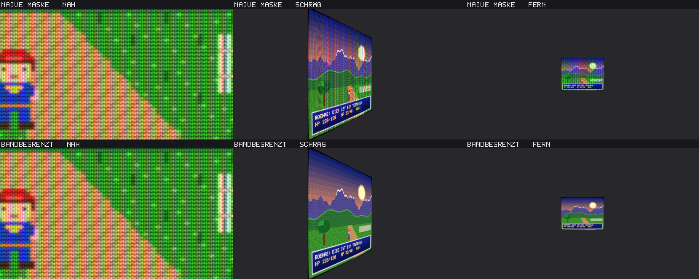

# Etappe 2: Eingangsstufe, Moiré-Messung, HDR

Stand: 2026-11-02

## Was gebaut wurde

| Teil | Inhalt |
|---|---|
| Virtuelle Zeilenzahl | Eigener Shader `shader/eigen/virtuelle-zeilen.slang` (flächentreues Verkleinern in linearem Licht) als eigene librashader-Kette **vor** der Röhre. So sieht guest-advanced das verkleinerte Bild als „Original“ und erkennt Zeilenzahl und Zeilensprung richtig. Optionen `eingang.zeilen` (0 = automatisch) und `eingang.waagerecht` (Bildpunkte je Zeile, Standard 2 × quadratisch). |
| Automatik | Eingang über 600 Zeilen → 240 Röhrenzeilen; ab einer Fläche von 1920 px Höhe (4K) → 480. Grund: Eine Zeile braucht mindestens 4 Bildschirmpixel. Gemessen: 480 Zeilen auf 1080p (2,25 px je Zeile) erzeugen ein deutliches Schwebungsmuster. |
| Moiré-Messung | `roehre-pruefstand moire`: graues Feld, Profil über genau eine Zeilen- bzw. Maskenperiode integriert, langsame Verläufe abgezogen, größte Restschwankung in Prozent. Mit eigenen Prüfläufen (gleichmäßiges Muster ≈ 0 %, schwebendes Muster erkannt). |
| HDR | `Ausgabe::scrgb()` (Rgba16Float, 1,0 = 80 nit) und `Ausgabe::hdr10()` (BT.2020 nach ITU-R BT.2087, PQ nach SMPTE ST 2084), eigene Formeln. **Helligkeitseichung**: Eine zweite Kette (damit Nachglühen und Verlauf des Spielbilds unberührt bleiben) zeichnet bei jeder Einstellungsänderung eine weiße Fläche und misst die Transmission. Der Zusammensetz-Pass skaliert so, dass Weiß im Mittel `helligkeit.hdr_weiss` erreicht; die Leuchtstreifen werden heller, weich begrenzt bei `helligkeit.hdr_spitze`. In HDR ist die Maske etwa 55 % kräftiger, helle Bildteile werden nicht angehoben (nichts wird bei 1,0 abgeschnitten). |
| Prüfstand | `roehre-pruefstand hdr`: Leuchtdichten in nit aus scRGB und HDR10. Entwicklerhilfe `ROEHRE_ROHPARAMETER="name=wert,…"` für Abstimmversuche. |

| Flächen-Modus (3D-Monitor) | `Roehre::zeichne_flaeche` zeichnet das Röhrenbild **ohne Maske** in ein `FlaechenZiel` (Rgba8Unorm mit sRGB-Ansicht, Mipmaps in linearem Licht) und liefert `MaterialWerte`. Die Maske rechnet das Material des Spiels mit `shader/eigen/flaeche/roehre_maske.wgsl` (dazu `.glsl` und `.hlsl`): Streifen und Schlitze als wenige Wellen, jede wird über die Ableitungen der UV-Koordinaten weich ausgeblendet, bevor sie die Abtastgrenze erreicht. Mittelwert 1, die Helligkeit bleibt. Vorführung: `roehre-pruefstand flaeche`. |

## Messwerte

### Moiré (Zeilen- und Maskenschwebung, Faustregel: unter 1 % unsichtbar)

| Voreinstellung | Eingang | Ausgabe | px je Zeile | Zeilenschwebung | px je Tripel | Maskenschwebung |
|---|---|---|---:|---:|---:|---:|
| scart-rgb | SNES 256×224 | 1280×720 | 3.21 | 1.79 % | 3 | 0.07 % |
| scart-rgb | SNES 256×224 | 1920×1080 | 4.82 | 0.63 % | 3 | 0.08 % |
| scart-rgb | SNES 256×224 | 2560×1440 | 6.43 | 0.38 % | 4 | 0.18 % |
| scart-rgb | SNES 256×224 | 3840×2160 | 9.64 | 0.14 % | 6 | 0.04 % |
| scart-rgb | N64 320×240 | 1280×720 | 3.00 | 0.06 % | 3 | 0.06 % |
| scart-rgb | N64 320×240 | 1920×1080 | 4.50 | 0.93 % | 3 | 0.08 % |
| scart-rgb | N64 320×240 | 2560×1440 | 6.00 | 0.08 % | 4 | 0.08 % |
| scart-rgb | N64 320×240 | 3840×2160 | 9.00 | 0.08 % | 6 | 0.05 % |
| scart-rgb | PAL 256×239 | 1280×720 | 3.01 | 0.38 % | 3 | 0.07 % |
| scart-rgb | PAL 256×239 | 1920×1080 | 4.52 | 0.99 % | 3 | 0.07 % |
| scart-rgb | PAL 256×239 | 2560×1440 | 6.03 | 0.19 % | 4 | 0.11 % |
| scart-rgb | PAL 256×239 | 3840×2160 | 9.04 | 0.16 % | 6 | 0.04 % |
| wohnzimmer-90er-composite | SNES 256×224 | 1280×720 | 3.41 | 1.46 % | 3 | 0.09 % |
| wohnzimmer-90er-composite | SNES 256×224 | 1920×1080 | 5.12 | 0.52 % | 4 | 0.07 % |
| wohnzimmer-90er-composite | SNES 256×224 | 2560×1440 | 6.82 | 0.20 % | 6 | 0.05 % |
| wohnzimmer-90er-composite | SNES 256×224 | 3840×2160 | 10.24 | 0.19 % | 8 | 0.04 % |
| wohnzimmer-90er-composite | N64 320×240 | 1280×720 | 3.19 | 1.25 % | 3 | 0.17 % |
| wohnzimmer-90er-composite | N64 320×240 | 1920×1080 | 4.78 | 0.61 % | 4 | 0.17 % |
| wohnzimmer-90er-composite | N64 320×240 | 2560×1440 | 6.37 | 0.28 % | 6 | 0.16 % |
| wohnzimmer-90er-composite | N64 320×240 | 3840×2160 | 9.56 | 0.13 % | 8 | 0.15 % |
| wohnzimmer-90er-composite | PAL 256×239 | 1280×720 | 3.20 | 1.29 % | 3 | 0.11 % |
| wohnzimmer-90er-composite | PAL 256×239 | 1920×1080 | 4.80 | 0.66 % | 4 | 0.06 % |
| wohnzimmer-90er-composite | PAL 256×239 | 2560×1440 | 6.40 | 0.35 % | 6 | 0.07 % |
| wohnzimmer-90er-composite | PAL 256×239 | 3840×2160 | 9.60 | 0.16 % | 8 | 0.03 % |

Bewertung: Die Maske ist überall frei von Moiré (höchstens 0,2 %). Die Zeilen liegen ab 1080p
bei höchstens 1,1 %, ab 1440p unter 0,6 %. Nur bei 720p bleiben bis 1,8 %: Dort hat eine
SNES-Zeile 3,2 Bildschirmpixel, und das Strahlprofil lässt sich nicht gleichmäßig abtasten.
Empfehlung für 720p: `bildformat.ganzzahlig = true` (dann 3 px je Zeile, gemessen 0,05 %).

### HDR (Farbbalken, Weiß auf 200 nit, Spitze 1000 nit)

| Voreinstellung | Transmission Weiß | 75-%-Weiß (scRGB) | 75-%-Weiß (HDR10) | 100-%-Weiß | hellster Punkt |
|---|---:|---:|---:|---:|---:|
| aus | 0.400 | 106 nit | 106 nit | 200 nit | 200 nit |
| scart-rgb | 0.399 | 96 nit | 96 nit | 200 nit | 423 nit |
| wohnzimmer-90er-composite | 0.624 | 101 nit | 101 nit | 191 nit | 296 nit |

scRGB und HDR10 liefern dieselben Leuchtdichten (Gegenprobe über zwei unabhängige Kodierungen).
100-%-Weiß trifft 200 nit. Beim Composite-Fernseher liegt das Messfeld nahe der Ecke, die
Randabdunklung kostet dort etwas. Die Leuchtstreifen der Maske erreichen 300 bis 420 nit.

### Helligkeit SDR (75-%-Weiß, linear, Mittel über den Balken)

| Voreinstellung | Leuchtdichte | Anteil vom sauberen Bild |
|---|---:|---:|
| aus | 0,521 | 100 % |
| scart-rgb | 0,518 | 99 % |
| wohnzimmer-90er-composite | 0,519 | 100 % |

## Fotos

- Übersicht 1080p: [uebersicht_1080p.jpg](../bilder/etappe-2/uebersicht_1080p.jpg)
- Übersicht 4K (Pixelszene, 3D-Szene): [uebersicht_4k.jpg](../bilder/etappe-2/uebersicht_4k.jpg)
- 1:1-Ausschnitte: `docs/bilder/etappe-2/*_1zu1.png`. Die 3D-Szene (1920×1080 Eingang) zeigt jetzt
  echte Röhrenzeilen: 240 bei 1080p, 480 bei 4K.

### Flächen-Modus

Obere Reihe: dieselbe Maske ohne Bandbegrenzung. Schräg betrachtet entstehen kräftige
Regenbogenbänder, aus der Ferne flimmert die Farbe. Untere Reihe: `roehre_maske`. Aus der
Nähe sind Farbstreifen, Schlitze und Zeilen zu sehen, schräg und fern bleibt die Fläche
ruhig. Geprüft: WGSL und GLSL mit naga validiert. **HLSL ist ungeprüft** (hier gibt es keinen
DXC); die Fassung ist eine wörtliche Übertragung.

## Fehler, die in dieser Etappe gefunden und behoben wurden

1. **Voreinstellungen beschädigt (seit Etappe 1).** Beim Helligkeitsabgleich in Etappe 1 hat ein
   Bearbeitungsskript die Abschnitte `[maske]`, `[leuchtstoff]`, `[licht]` und `[geometrie]`
   aus `scart-rgb` und `wohnzimmer-90er-composite` gelöscht. Die Dateien luden trotzdem ohne
   Hinweis, nur eben mit Standardwerten. Die Fotos und Helligkeitswerte von Etappe 1 gelten
   deshalb nur eingeschränkt. Aufgefallen ist es bei der HDR-Messung: Die Maskenstärke wirkte
   mit 0,30 statt 0,45. Behoben, dazu ein neuer Prüflauf
   `roehren_voreinstellungen_nennen_alle_hauptgruppen`.
2. **Overscan halbiert.** guest-advanced zählt `overscanX/Y` als Summe beider Seiten, das Modell
   verspricht Prozent je Seite. Jetzt wird verdoppelt (`roehre_kette::overscan_pixel`).
3. **Messfehler der Moiré-Messung bei Overscan.** Die Periode wurde aus allen Eingangszeilen
   berechnet statt aus den sichtbaren. Behoben.

## Selbstkritische Abnahme

| Frage | Befund |
|---|---|
| Moiré? | Maske nirgends, Zeilen ab 1080p ≤ 1,1 %. 720p ist knapp (bis 1,8 %); siehe Empfehlung oben. |
| Zu dunkel? | SDR 99–100 % des sauberen Bildes. HDR: Weiß wie eingestellt, Mitteltöne leicht unter dem sauberen Bild (96 statt 106 nit beim Scart-Fernseher). |
| Farben? | Unverändert gegenüber Etappe 1. |
| 3D-Bild? | Jetzt mit echten Zeilen, waagerecht scharf. |
| Composite-Schrift | Rote und blaue Schrift auf Schwarz ist weiterhin sehr weich und zeigt Regenbogen. Am echten Gerät ist das ähnlich, aber hier ist es eher zu stark. **Abstimmung in Etappe 3**, dann mit Vergleich zu blargg snes_ntsc als Referenz. |
| HDR auf echtem Bildschirm | Nur gemessen, nicht gesehen. Hier gibt es keinen HDR-Bildschirm; das Ansehen muss auf dem Rechner des Auftraggebers geschehen. |

## Offen

- Flächen-Modus: Wölbung des Glases und Spiegelungen liefert das 3D-Modell des Spiels; eine
  passende Glasformel und Spiegelung kommen mit dem Gehäuse (Etappe 4). Die Helligkeit ohne
  Maske ist noch nicht gegen die SDR-Darstellung abgeglichen.
- Abstimmung der Composite-Signalstufe, restliche Voreinstellungen, Referenzbilder in CI: Etappe 3.
