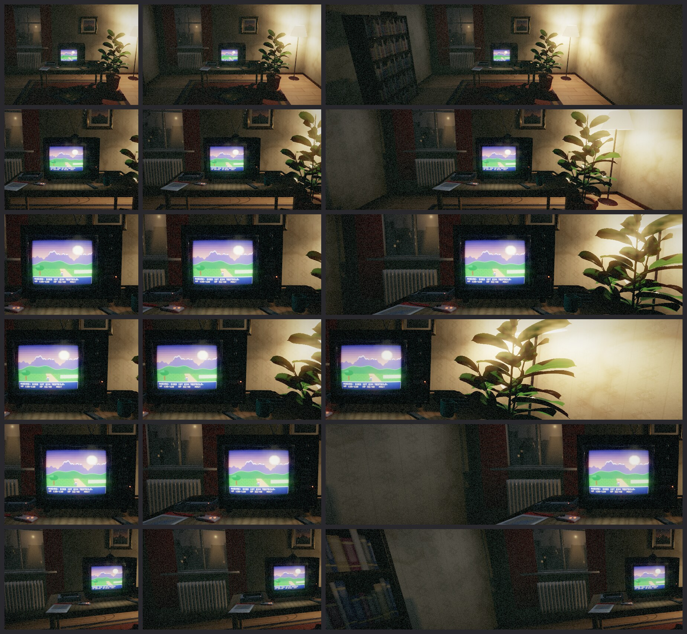

# Etappe 6: Vorschau-Programm und 3D-Vorführraum

## Was gebaut ist

* **Vorschau** (`crates/roehre-vorschau`, eframe/wgpu): Testbild, eigene PNGs, Bildfolgen,
  Schwenktest, A/B-Vergleich mit Schieber, Lupe, Bildschirmfoto, alle Optionen aus dem
  Katalog; Ansicht „3D-Raum“ mit Regler für Nähe, Schwenk, Licht, Flackern und Korn.
* **3D-Raum** (`crates/roehre-raum`): ein Wohnzimmer der späten 80er bei Nacht, Vorlage für das
  „TV-Erlebnis“ des Mission:-Impossible-Ports (Wunsch W-004). Alles berechnet: Geometrie aus
  `szene.rs`, Texturen aus `texturen.rs`, keine Fremddaten. Der Bildschirm ist die Röhre selbst
  (Flächen-Modus), er beleuchtet den Raum.

## Rückmeldungen des Anwenders und was daraus wurde

| Rückmeldung | Umsetzung |
|---|---|
| Fernseher zu klein, zu rund, nicht wie ein 80er-Gerät | Neubau als Raster-Szene: hohles Furniergehäuse, Bedienfeld, Antenne, gewölbte Röhre |
| Richtung Silent Hill 2/3, späte PS2, nicht Comic, nicht fotorealistisch | Nebel, Korn, Vignette, entsättigte Farben, Schmutz in den Raumkanten, Wasserflecken |
| Pflanze zu künstlich, Blätter zu kurz (Vorbild: Gummibaum aus Sims 1) | Ficus elastica: drei Triebe, große ovale, längs gefaltete Blätter an Stielen, durchscheinend |
| Lampe in die Ecke, Pflanze neben den Tisch | `LAMPE` hinten rechts, `PFLANZE` rechts neben dem Tisch |
| Bilderrahmen langweilig, eigenes Foto als Platzhalter | Goldrahmen mit Profil, Passepartout; `Raum::wandbild_setzen` (Foto bleibt lokal, nicht im Repository) |
| Fernbedienung zu knubbelig, lieber Texturen als Polygone | flaches Gehäuse, Tasten als Textur |
| Parkett und Tisch wie Laminat, Spiegelung nicht wie Holz | Wildeiche mit Ästen, Rissen, Farbspiel; matt geölt |
| Texturen pixelig mit sichtbaren Rohpixeln, nicht verschmiert | 256², Abtastung rastet auf die Texelmitte ein (Mip/Anisotropie bleiben) |
| Blick aus dem Fenster zu comichaft | Neblige Nacht: Laterne mit Hof, schemenhafte Häuser, kahler Baum, wenige trübe Fenster |

## Kamera (Wünsche W-005, W-006 des Mission:-Impossible-Ports)

Optionen der Gruppe `raum` im Katalog, mit Festwerten für Menüs (`festwerte()`):
`raum.naehe` (weit/mittel/nah), `raum.blickwinkel` (links/vorn/rechts), `raum.schwenk` und
`raum.schwenk_staerke`, `raum.lage` (links/mitte/rechts), dazu `raum.licht`, `raum.flackern`,
`raum.korn`, `raum.unschaerfe`, `raum.gluehen`. Rust: `Ansicht::aus_einstellungen(&e, zeit,
seitenverhaeltnis)`.

* **Nähe** ist der Anteil des Geräts an der Fensterhöhe (24 / 45 / 80 %), nicht ein
  Kameraabstand – nur so stimmt der Rand bei jedem Format. Ist das Fenster zu schmal, wird
  zurückgenommen, bis das Gerät in die Breite passt.
* **Lage im Fenster** per außermittiger Projektion: die Kamera bleibt, der Ausschnitt wandert.
  Das Gerät bleibt unverzerrt, höchstens bis 1,5 % an den Rand.
* **Schwenk** kreist um das Gerät und blickt auf seine Mitte; Abstand und Verschiebung bleiben
  fest, das Gerät steht still im Bild.
* Grenzfall, ehrlich: bei 4:3 in Nah füllt das Gerät fast die ganze Breite, es bleibt kaum Platz
  zum Verschieben.

Kontaktbogen (`roehre-pruefstand kamera`): Spalten 4:3, 16:9, 32:9; Zeilen weit, mittel, nah,
nah links, nah rechts, mittel leicht von links mit Gerät rechts.

## Selbstkritische Abnahme

* Gut: Gerät nie abgeschnitten (Prüflauf über 6 Formate × 5 Nähen × 5 Blickwinkel × 5 Lagen),
  Schwenk hält die Mitte auf 10⁻⁴ genau, Glühen ohne Geisterpunkte seit der 1/8-Stufe.
* Schwach: bei 32:9 nah ist die linke Bildhälfte Wand im Halbdunkel; die Unschärfe rauscht
  leicht an Kanten (geht im Korn auf); das Glühen kleiner Lichter ist etwas grob.
* Ungeprüft: alles auf echter GPU, insbesondere die Kosten von Unschärfe und Glühen bei 4K.

## Bilder

`docs/bilder/etappe-6/raum_*.jpg` (Prüfstand `roehre-pruefstand raum`, 1920×1080, lavapipe).

## Offen

* Wirkung und Leistung auf echter GPU (Anwender).
* Übertragung auf D3D12/Vulkan (Etappe 7, C-API).
