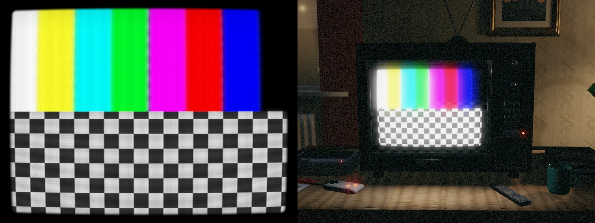
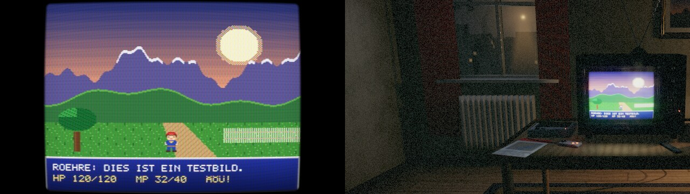

# Etappe 7: C-Schnittstelle für Vulkan und D3D12

## Was gebaut ist

Neue Kiste `crates/roehre-c` (Bibliothek `libroehre` / `roehre.dll`), Schnittstelle
`include/roehre.h`, Überblick `crates/roehre-c/LIESMICH.md`.

| Teil | Wofür |
|---|---|
| Katalog als JSON | ein Launcher baut sein Menü selbst: Schlüssel, deutscher Name, Beschreibung, Grenzen, Standard, Festwerte (W-006) |
| Einstellungen | laden (TOML/JSON, Voreinstellung), setzen (Wert als Text), speichern |
| Vorschaubild | RGBA-Bild in den Arbeitsspeicher, flach oder 3D-Raum, für Programme ohne Shader (W-007) |
| Austausch Vulkan / D3D12 | Spiel mit eigenem Renderer: Bild rein, Röhrenbild raus, flach oder Raum, ab 120 Hz im Takt (W-001) |

## Die eine große Entscheidung

Gewünscht war „fertige Textur + Ziel je Bild auf dem Gerät des Spiels“. Das geht mit wgpu, auf
dem roehre aufbaut, nicht sauber:

* Ein fremdes **D3D12**-Gerät kann wgpu 30 gar nicht übernehmen.
* Ein fremdes **Vulkan**-Gerät nur, wenn es mit genau den Funktionen angelegt wurde, die wgpu
  erwartet. RT64/plume schaltet z. B. keine Timeline-Semaphoren ein; wgpu würde sie trotzdem
  benutzen (undefiniertes Verhalten).
* Die Alternative – alle eigenen Pässe (Gehäuse, HDR, Strahlsimulation, Eichung, 3D-Raum) von
  Hand nach HLSL und SPIR-V zu portieren und in fremde Befehlslisten aufzuzeichnen – wäre ein
  Vielfaches an Arbeit und an Fehlerquellen.

Daher: **roehre rechnet auf einem eigenen Gerät derselben Grafikkarte** und teilt mit dem Spiel
zwei Bilder in geteiltem Grafikspeicher und eine Synchronisation. wgpu 30 bietet dafür genau die
nötigen Haken (`open_with_callback` für die Erweiterungen, `add_wait_semaphore` /
`add_signal_semaphore` bzw. `add_wait_fence` / `add_signal_fence` an der Warteschlange,
`create_texture_from_hal` mit Anfangszustand, `transition_resources` für den Endzustand).

Preis: zwei Kopien je Bild auf der Grafikkarte (bei 4K grob 0,1 ms, ungemessen). Gewinn: unter
D3D12 **kein** Eingriff am Gerät des Spiels, unter Vulkan zwei Erweiterungen.

## Geprüft

| Was | Wie | Ergebnis |
|---|---|---|
| Katalog, Einstellungen, Vorschaubild | `beispiele/vorschau.c` mit gcc, lavapipe | läuft; unbekannte Option abgelehnt, Speichern und Wiedereinlesen gleich |
| Vulkan-Austausch | `beispiele/vulkan_spiel.c`: eigenes Gerät, Testmuster rein, Ergebnis zurück, flach und Raum | läuft auf lavapipe – aber im **Notweg** ohne geteilte Semaphoren (lavapipe hat `VK_KHR_external_semaphore_fd` nicht) |
| D3D12-Austausch | Windows-DLL quer gebaut (MinGW), `beispiele/d3d12_spiel.cpp` übersetzt und gelinkt | **nicht ausgeführt** (kein Windows hier) |

## Einbauanleitungen

* Mission: Impossible: `docs/integration/mission-impossible.md` – Einstiegsstelle in RT64
  (`PresentQueue::threadPresent` in `rt64_present_queue.cpp`), Ablauf für D3D12 und Vulkan,
  native Objekte aus plume.
* Terranigma: `docs/integration/terranigma.md` – direkt über `roehre-wgpu` nach dem Anheben auf
  wgpu 30 / egui 0.37.

## Selbstkritische Abnahme

* Gut: eine Schnittstelle für beide APIs, alle Funktionen (auch Raum und Strahlsimulation) ohne
  Portierung; keine Panik über die C-Grenze; Fehlertexte auf Deutsch.
* Schwach: der wichtigste Weg (D3D12 unter Windows) ist ungetestet; ebenso Vulkan mit
  Semaphoren. Größenwechsel heißt neu anlegen. Einstellungswechsel mit neuer Shaderkette
  blockiert bis etwa eine Sekunde. Der 3D-Raum liefert auch bei HDR-Ausgabe SDR-Helligkeiten.
  Die Spezifikation verlangt beim Teilen zwischen zwei Vulkan-Geräten genau genommen eine
  Übergabe mit `VK_QUEUE_FAMILY_EXTERNAL`; roehre lässt sie weg (gleiche Grafikkarte, gleicher
  Treiber) – auf echter Hardware zu prüfen.

## Nächste Etappe

Etappe 8: Leistung auf echter Grafikkarte messen (Messbefehl, getrennt Filter / 3D-Raum, 1080p /
4K, Kosten je Regler; W-008), D3D12-Beispiel unter Windows ausführen, Feinschliff, englische
Texte.
